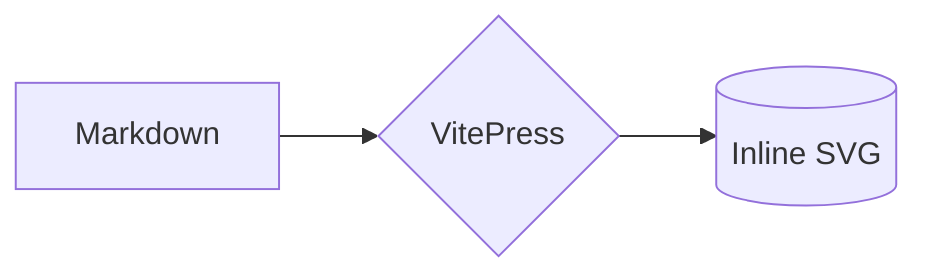
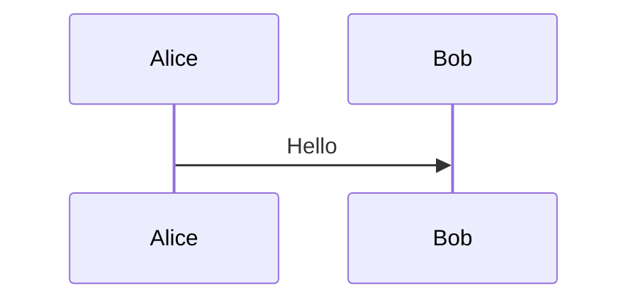

# vitepress-plugin-pele

[](https://www.npmjs.com/package/vitepress-plugin-pele)
[](https://github.com/miswanting/vitepress-plugin-pele/actions/workflows/ci.yml)
[](https://miswanting.github.io/vitepress-plugin-pele/)
[](LICENSE)
[](package.json)

Render Mermaid diagrams in VitePress **at build time** with [Pele](https://pele.run) — no mermaid.js bundle, no client-side JavaScript, no headless browser.

**Docs and live demo:** <https://miswanting.github.io/vitepress-plugin-pele/>

Write the same fenced code blocks you already have:

````md

````

…and get a static, themeable `<svg>` in the built HTML.

## Why Pele?

| | mermaid.js based plugins | vitepress-plugin-pele |
| --- | --- | --- |
| Client JS | ~1.6 MB mermaid bundle | **0 bytes** |
| Rendering | in the browser | **at build time** |
| SSR / no-JS / SEO | diagram missing | **inline SVG** |
| Build dependency | none | none (no Chromium) |
| Layout shift | on hydration | **none** |
| Interactive zoom/pan | usually yes | not yet (planned) |
| Syntax coverage | full Mermaid | Mermaid 12.1 types, stricter parsing |

Pele is a fast, dependency-free Mermaid → SVG renderer used by Obsidian. It renders synchronously, which is what makes build-time rendering in a markdown-it fence possible.

## Install

```bash
pnpm add -D vitepress-plugin-pele
# npm install -D vitepress-plugin-pele
# yarn add -D vitepress-plugin-pele
```

Requires Node.js 20+ and VitePress 1.6+.

## Quick start

### 1. Register the markdown transform

```ts
// .vitepress/config.ts
import { defineConfig } from "vitepress"
import { peleMermaid } from "vitepress-plugin-pele"

export default defineConfig({
  markdown: {
    config: peleMermaid(),
  },
})
```

If you already have a `markdown.config`, call `peleMermaid()` after your own plugins so it wraps the final fence renderer:

```ts
markdown: {
  config(md) {
    myPlugin(md)
    peleMermaid()(md)
  },
},
```

### 2. Load the theme styles

Create `.vitepress/theme/index.ts` (or add the import to your existing theme):

```ts
import DefaultTheme from "vitepress/theme"
import "vitepress-plugin-pele/style.css"

export default DefaultTheme
```

If you already extend the default theme, keep your theme object and just add the `style.css` import.

That's it. Existing ```` ```mermaid ```` blocks now render as inline SVG.

## Fence options

Set the layout width for a single diagram:

````md

````

`width` accepts a number, `480px`, `width=480`, `maxWidth=480`, or `{width=480}`. The value is passed to Pele as `maxWidth`, which lets it wrap labels and switch direction on narrow layouts.

## Options

```ts
peleMermaid({
  maxWidth: 688,
  responsive: true,
  className: "pele-diagram",
  vueSafe: true,
  onError: "warn",
  cache: true,
  idPrefix: "pele",
  renderOptions: {},
})
```

| Option | Type | Default | Description |
| --- | --- | --- | --- |
| `maxWidth` | `number` | `688` (VitePress entry) | Layout width in px. The default matches the VitePress content column (43rem). |
| `responsive` | `boolean` | Pele default (`true`) | Let the SVG shrink to its container. |
| `className` | `string` | `"pele-diagram"` | Class of the wrapper element. Set to `""` to omit the wrapper attribute. |
| `vueSafe` | `boolean` | `true` | Add `v-pre` to the wrapper so Vue does not interpret `{{ ... }}` in labels. |
| `onError` | `"warn" \| "throw" \| "code"` | `"warn"` | Invalid diagrams fall back to a code block, fail the build, or fall back silently. |
| `cache` | `boolean` | `true` | Cache identical diagrams across pages during a build. |
| `idPrefix` | `string` | derived from source | Prefix for accessibility ids inside the SVG. |
| `renderOptions` | `RenderOptions` | `{}` | Extra options forwarded to [`pele.render()`](https://pele.run/api). |

### Error handling

With the default `onError: "warn"`, a diagram Pele cannot parse is printed as a code block and the build continues with a warning that includes the file, line and the offending source:

```
[vitepress-plugin-pele] Failed to render Mermaid diagram in guide/architecture.md:12
at diagram line 3, column 7: ...
Falling back to a code block.
```

Use `onError: "throw"` in CI to make broken diagrams fail the build. Use `onError: "code"` if you prefer a silent fallback.

## Theming

Pele colors the SVG with CSS variables, so diagrams follow light and dark mode **without re-rendering**. The bundled stylesheet maps them to the VitePress palette:

| Pele variable | VitePress variable |
| --- | --- |
| `--pele-bg` | `--vp-c-bg` |
| `--pele-fg` | `--vp-c-text-1` |
| `--pele-muted` | `--vp-c-text-2` |
| `--pele-line` | `--vp-c-text-2` |
| `--pele-surface` | `--vp-c-bg-soft` |
| `--pele-surface-alt` | `--vp-c-bg-alt` |
| `--pele-border` | `--vp-c-divider` |
| `--pele-accent` | `--vp-c-brand-1` |
| `--pele-font` | `--vp-font-family-base` |

Override them in your own CSS:

```css
:root {
  --pele-accent: #ff6b35;
  --pele-radius: 8px;
}
```

See the [Pele theming guide](https://pele.run/theming) for the full list, including series colors and per-element classes.

## Plain markdown-it

The renderer is also available as a regular markdown-it plugin, without the VitePress defaults:

```ts
import MarkdownIt from "markdown-it"
import markdownItPele from "vitepress-plugin-pele/markdown-it"

const md = new MarkdownIt().use(markdownItPele, { maxWidth: 720 })
```

In this entry `maxWidth` is left undefined by default, so Pele uses the diagram's natural width. `style.css` assumes VitePress variables; outside VitePress, define `--pele-*` variables yourself.

## How it works

1. `peleMermaid()` registers a markdown-it fence rule through VitePress's `markdown.config` hook.
2. Every ```` ```mermaid ```` fence is rendered with `pele.render()` during the build.
3. The resulting SVG is inlined into the page and wrapped in `<div class="pele-diagram" v-pre>`.
4. Nothing diagram-related ships to the browser — only the CSS.

Because Pele is synchronous and does not need a DOM, this works in Node without Puppeteer or Playwright. Text widths are estimated with Pele's built-in width table during the build; if your site uses a very different font metric, adjust `--pele-font` or pass `renderOptions.fontFamily`.

## Documentation site

The documentation and live demo live under [`docs/`](docs) and are deployed to
<https://miswanting.github.io/vitepress-plugin-pele/> on every push to `main`:

```bash
pnpm install
pnpm dev:docs        # http://localhost:5180
pnpm build:docs      # static build
pnpm preview:docs    # preview the static build
```

It includes a diagram gallery, sizing examples, dark-mode theming, and the error-handling behavior.

## Compatibility

| VitePress | Status |
| --- | --- |
| `2.0.0-alpha.x` | tested in CI |
| `1.6.x` | tested manually (1.6.4) |

Node.js 20+ is required. VitePress 2 itself requires Node 22. The package is ESM-only and ships its own TypeScript declarations.

## Migrating from `vitepress-plugin-mermaid`

1. Remove `vitepress-plugin-mermaid` and `mermaid` from your dependencies.
2. Replace `withMermaid(defineConfig(...))` with a plain `defineConfig`.
3. Add `peleMermaid()` to `markdown.config` and import `vitepress-plugin-pele/style.css`, as shown above.
4. Run your build. Any diagram Pele rejects is reported with its file and line number; fix the syntax or keep the fallback code block.

Your Markdown does not change. Diagram features that depend on mermaid.js (custom `themeVariables`, directives, interactive zoom) are not supported; colors are controlled with `--pele-*` CSS variables instead.

## Limitations

- **Build-time only.** Diagrams are static SVG. Interactive zoom/pan is planned.
- **Stricter parser.** Pele supports the Mermaid 12.1 diagram types but rejects some malformed diagrams mermaid.js tolerates.
- **No Mermaid config compatibility.** `theme`, `themeVariables`, and most directives are ignored; use CSS variables.
- **Approximate text metrics at build time.** Pele measures labels with a built-in table when no canvas is available.
- **No HTML labels.** Label content is sanitized and rendered as SVG text.

## Contributing

Contributions are welcome. Please read [CONTRIBUTING.md](CONTRIBUTING.md) and the [Code of Conduct](CODE_OF_CONDUCT.md) first.

- Bug reports: use the issue template and include a minimal reproduction.
- Security issues: see [SECURITY.md](SECURITY.md), please do not open a public issue.

## License

[MIT](LICENSE)
