# Diagram gallery

Every diagram below is a plain `mermaid` fence rendered by Pele during the build. Open the navbar color-mode toggle: the SVGs follow the palette without being re-rendered.

## Flowchart

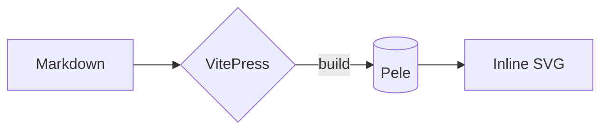

## Sequence diagram

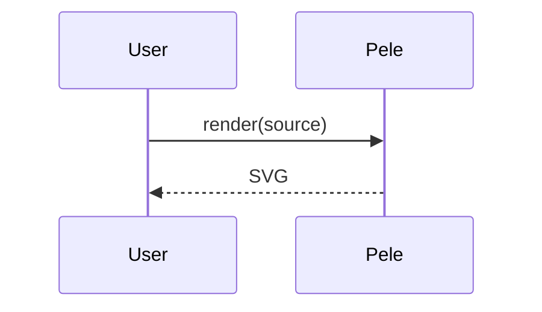

## State diagram

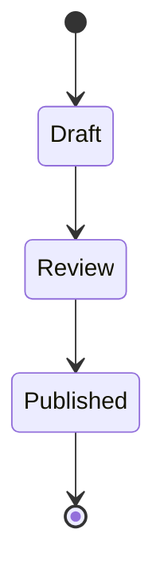

## Class diagram

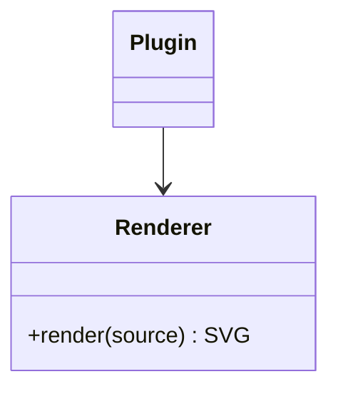

## Entity relationship

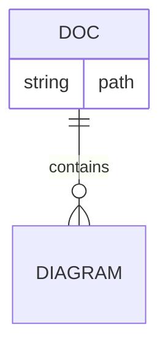

## Gantt

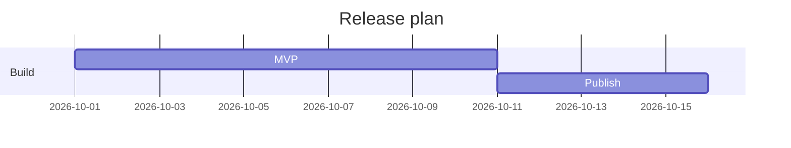

## Pie chart

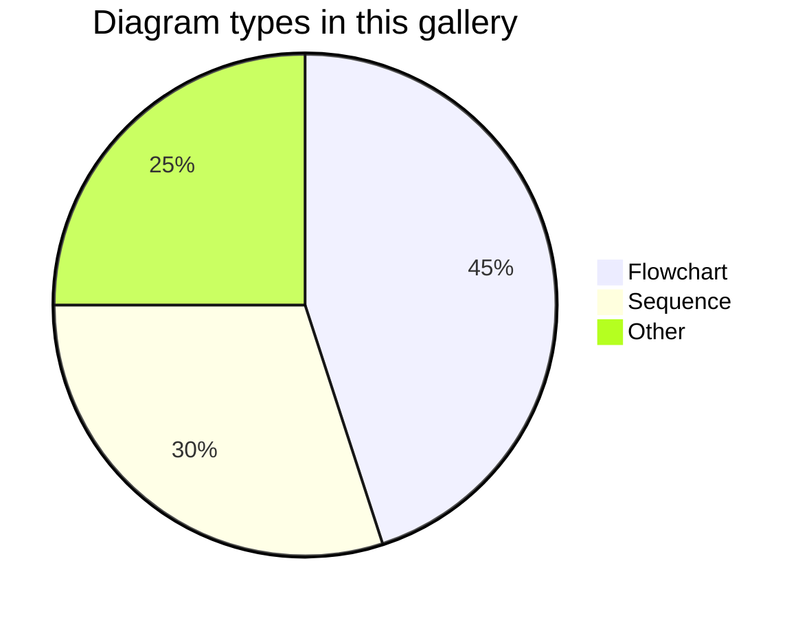

## Mindmap

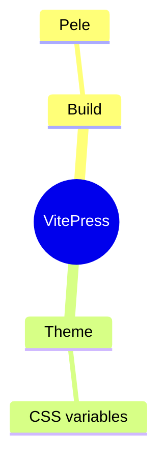

## Git graph

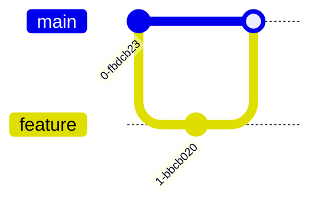

## Journey

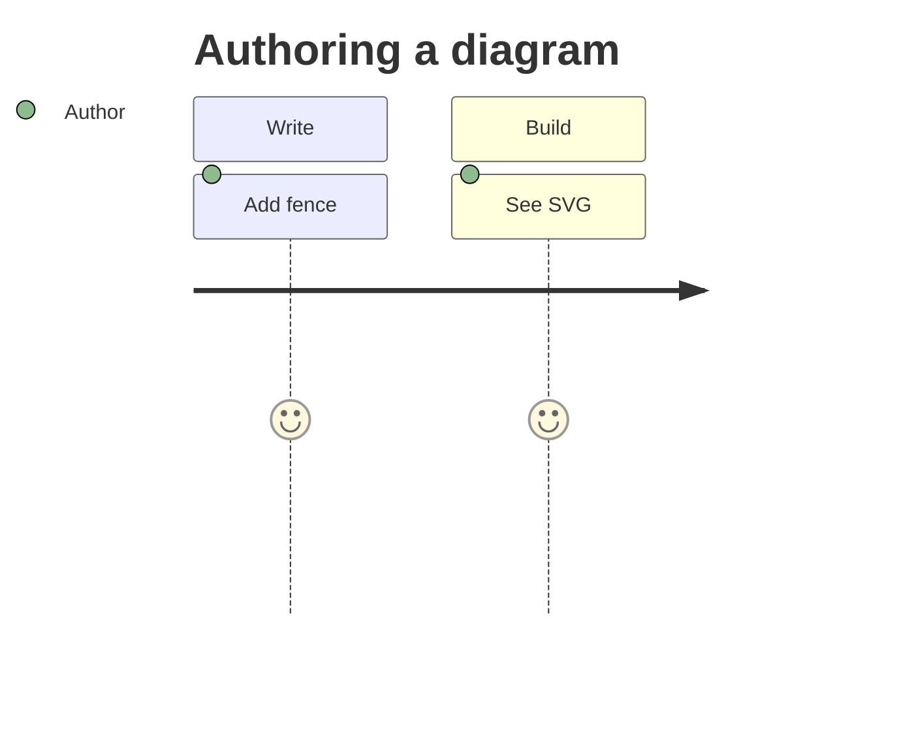

## Timeline

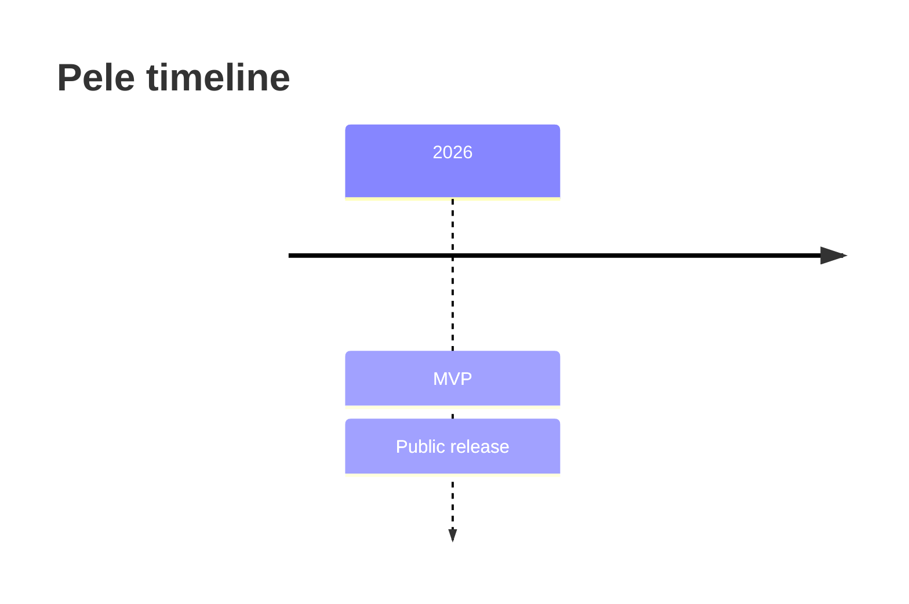

## Quadrant chart

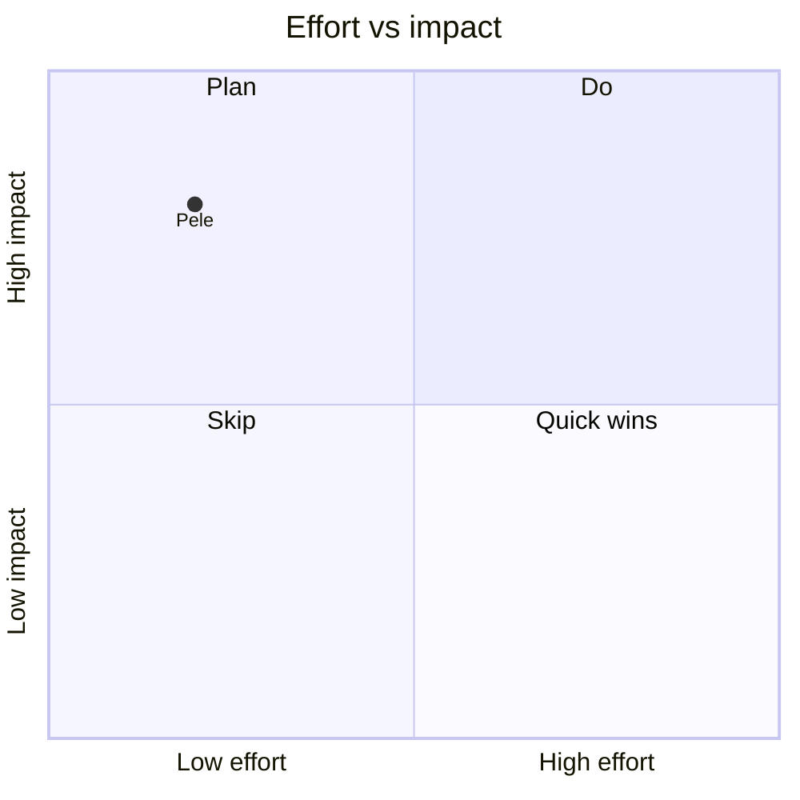

## XY chart

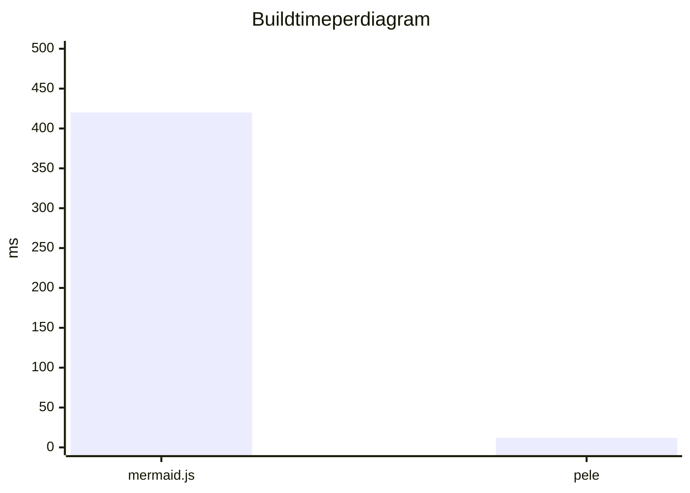

## Literal braces

Vue interpolation syntax inside labels is preserved because the wrapper is compiled with `v-pre`:

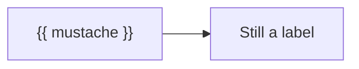
