# Diagram gallery

Every diagram below is a plain `mermaid` fence rendered by Pele during the build. The gallery covers every diagram type Pele supports. Open the navbar color-mode toggle: the SVGs follow the palette without being re-rendered.

## Flowchart

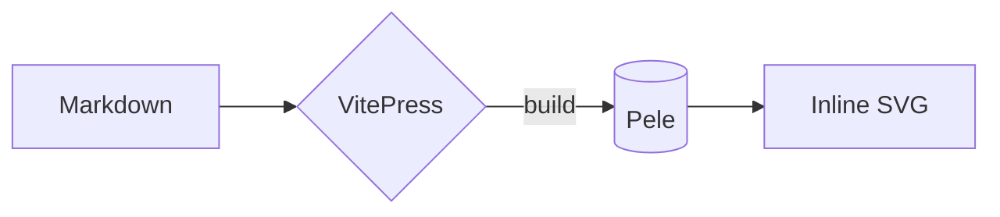

## Sequence diagram

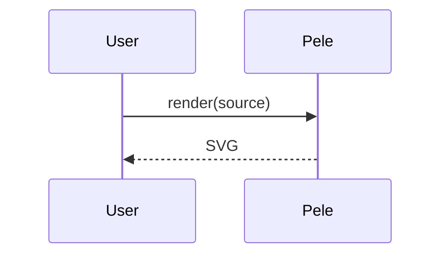

## State diagram

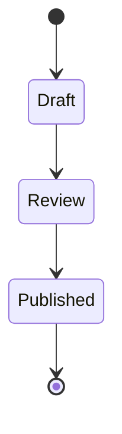

## Class diagram

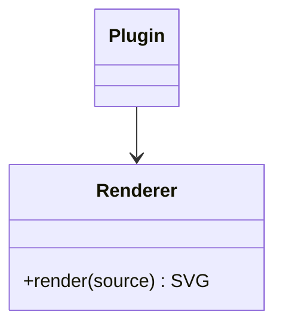

## Entity relationship

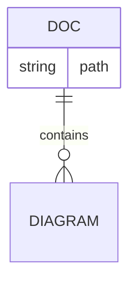

## Gantt

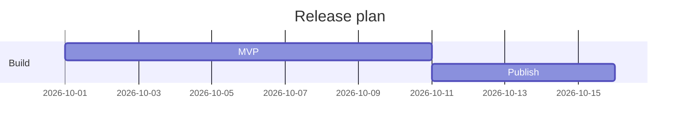

## Pie chart

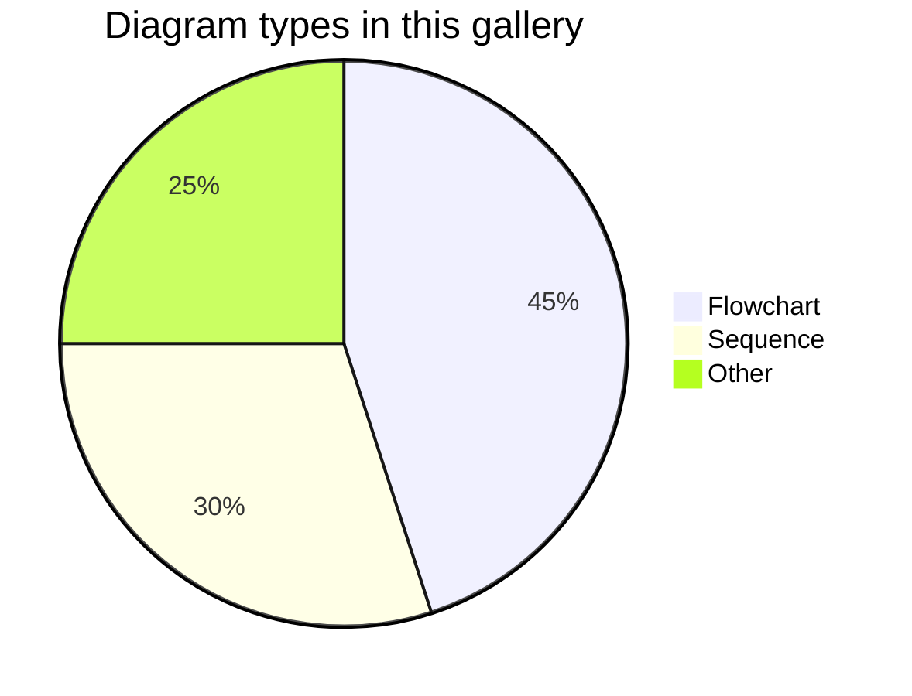

## Mindmap

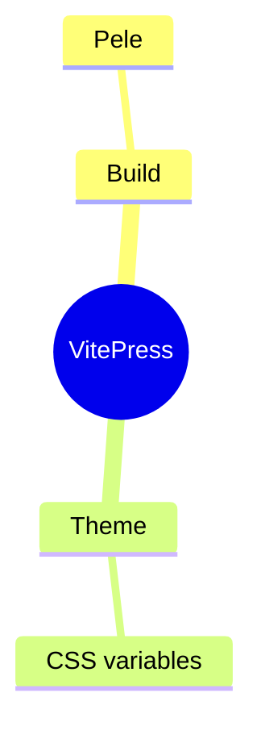

## Git graph

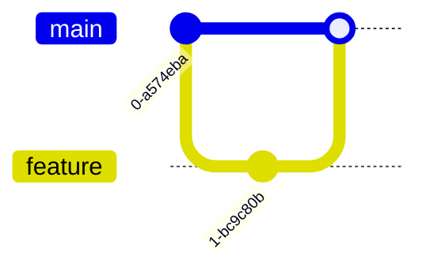

## Journey

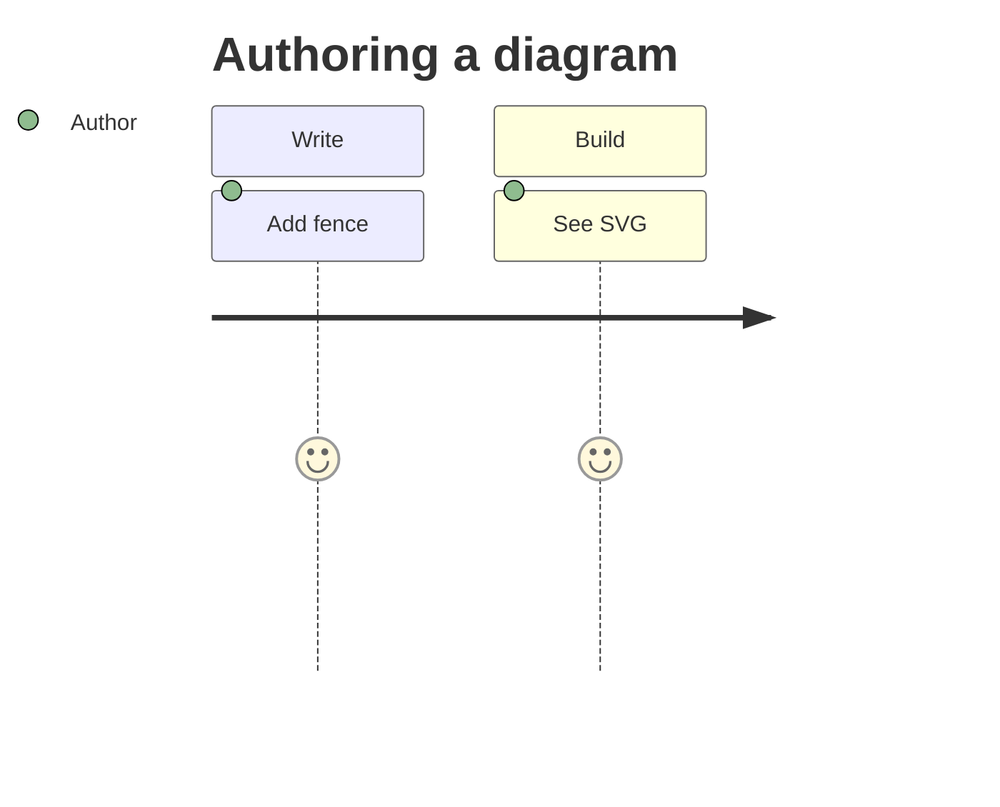

## Timeline

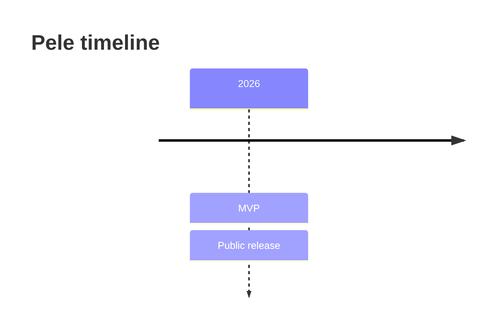

## Quadrant chart

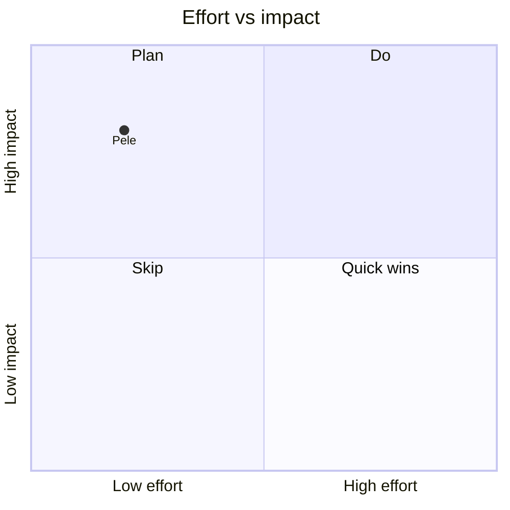

## XY chart

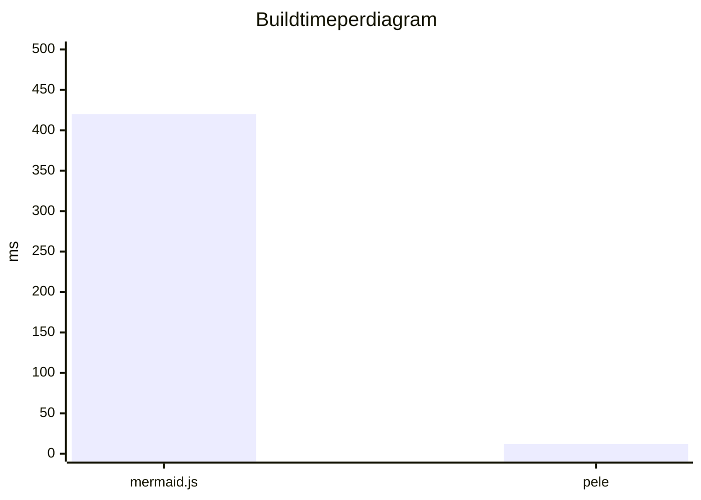

## Requirement diagram

Requirements, elements and the relations between them.

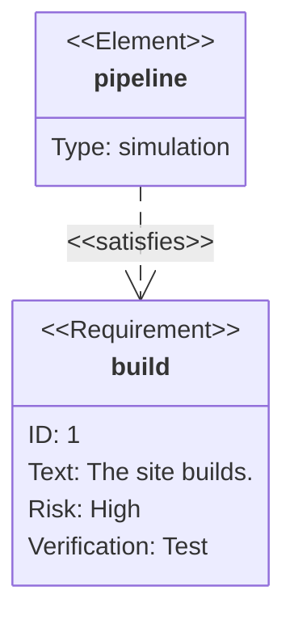

## C4 context diagram

People, systems and the relationships between them.

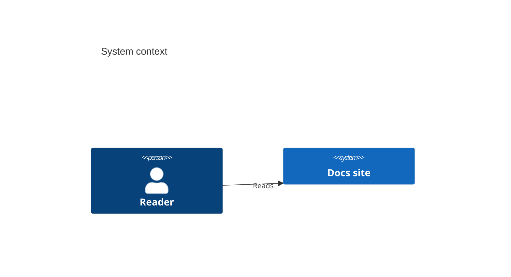

## Sankey diagram

How a quantity flows between nodes.

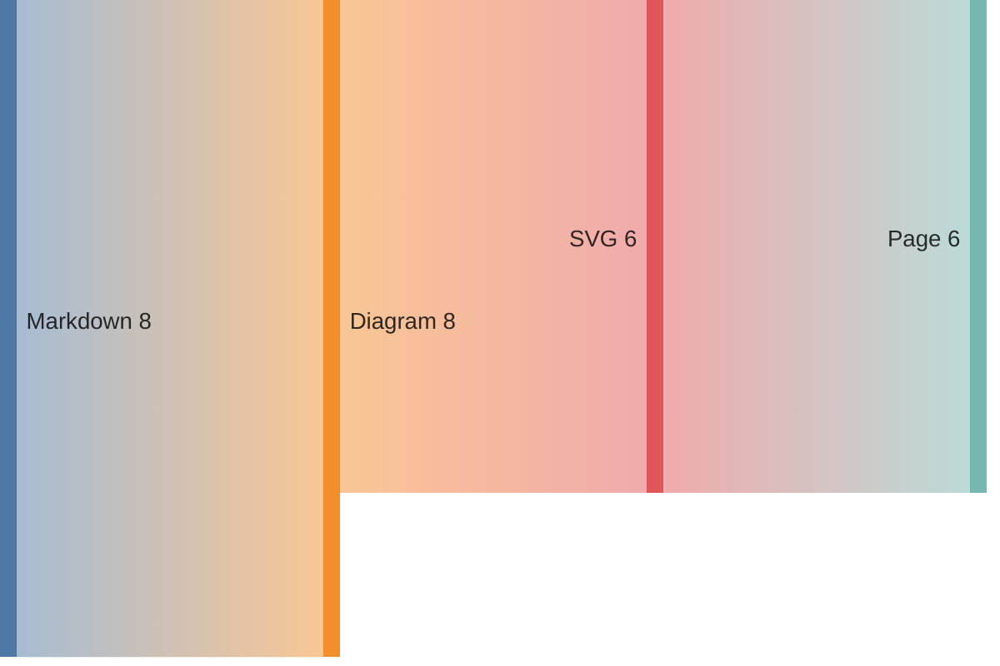

## Block diagram

A grid of labelled blocks.

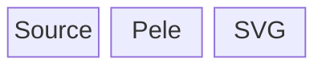

## Packet diagram

The bit layout of a network packet.

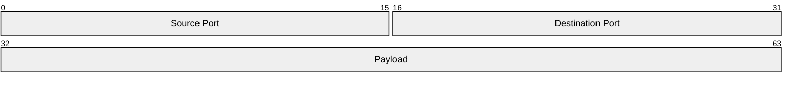

## Kanban board

Columns of tasks, from todo to done.

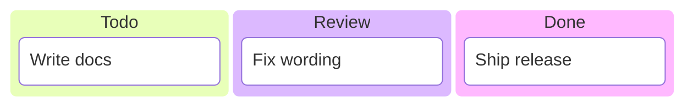

## Architecture diagram

Services grouped into boundaries.

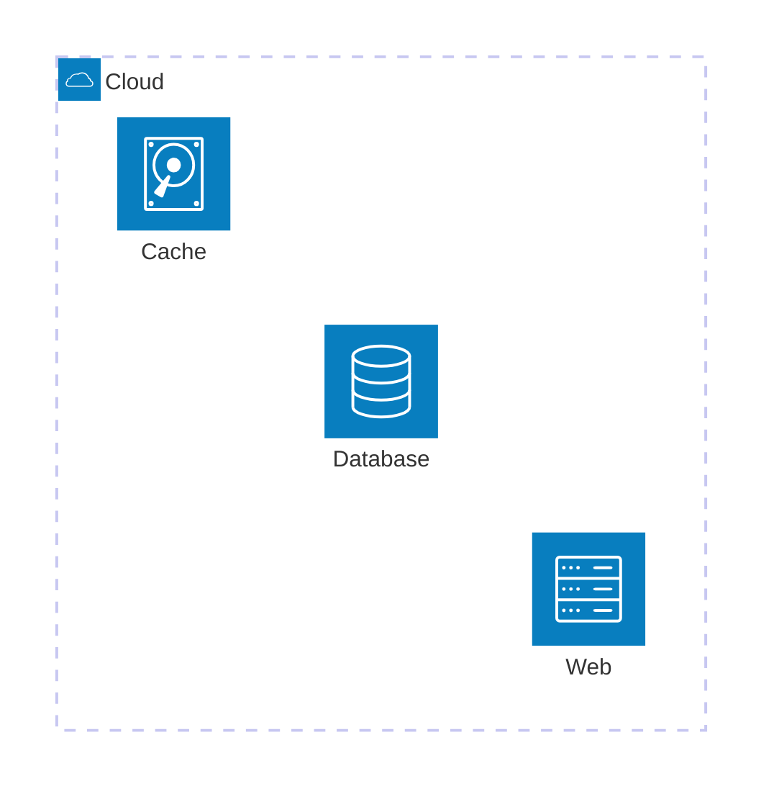

## Radar chart

One or more series over shared axes.

```mermaid
radar-beta
  axis a["Speed"], b["Cost"], c["Quality"]
  curve mermaids { 3, 2, 4 }
  curve pele { 4, 5, 4 }
```

## Treemap

Nested areas sized by value.

```mermaid
treemap
  "Docs"
    "Guide": 8
    "API": 4
  "Code"
    "Plugin": 6
```

## Info

The renderer version, rendered like any other diagram.

```mermaid
info
```

## Agent flow

A flow of agents and the tools they use.

```mermaid
agentflow-beta
  user[User] --> tool[Pele]
  tool --> result[SVG]
```

## Use case diagram

Actors and the use cases they trigger.

```mermaid
usecase-beta
  actor Reader
  Reader --> Gallery
```

## Railroad diagram

A grammar rule drawn as a railroad.

```mermaid
railroad-beta
  request = sequence(terminal("GET"), terminal("/page"));
```

## Tree view

A hierarchy of nodes.

```mermaid
treeView-beta
  root((Docs))
    Guide
    API
```

## Venn diagram

Sets and their overlaps.

```mermaid
venn-beta
  title Sets
  set A
  set B
  union A, B
```

## Cynefin domain

The five Cynefin domains and their orientation.

```mermaid
cynefin-beta
  complicated
  complex
  clear
```

## Wardley map

Evolution against visibility.

```mermaid
wardley-beta
  title Map
  component Web app [0.9, 0.8]
  component Docs [0.7, 0.5]
```

## Swimlane

Steps grouped into lanes.

```mermaid
swimlane-beta
  subgraph Client
    A[Request]
  end
  subgraph Server
    B[Response]
  end
```

## Ishikawa diagram

A cause and effect fishbone.

```mermaid
ishikawa-beta
  Slow build
    Cold cache
    Large assets
```

## Event modeling

Entities and the commands that act on them.

```mermaid
eventmodeling
  entity Order
  timeframe 1 command Order
```

## Literal braces

Vue interpolation syntax inside labels is preserved because the wrapper is compiled with `v-pre`:

```mermaid
flowchart LR
  A["{{ mustache }}"] --> B[Still a label]
```
