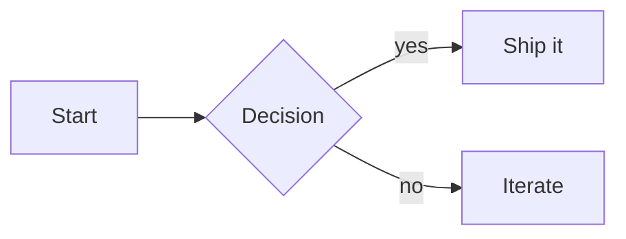
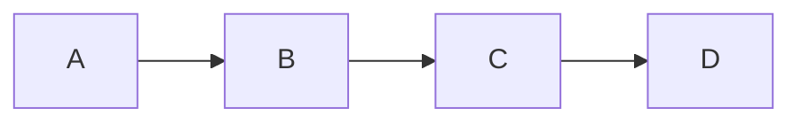

# Quick start

This demo runs the published plugin on **VitePress 2.0.0-alpha.20** (the `next` tag). Nothing in this site is client-side rendered beyond VitePress itself.

## Install

```bash
pnpm add -D vitepress-plugin-pele
```

## Configure VitePress

```ts
// .vitepress/config.ts
import { defineConfig } from "vitepress"
import { peleMermaid } from "vitepress-plugin-pele"

export default defineConfig({
  markdown: {
    config: peleMermaid(),
  },
})
```

## Load the styles

```ts
// .vitepress/theme/index.ts
import DefaultTheme from "vitepress/theme"
import "vitepress-plugin-pele/style.css"

export default DefaultTheme
```

## Write diagrams

````md

````


That's the whole integration. Existing `mermaid` fences keep working unchanged.

## Per-diagram width

Pele can wrap labels and switch direction when it knows the available width. Override the default 688px for a single diagram:

````md

````


See [sizing](/sizing) for more, or the [gallery](/gallery) for every supported diagram type.

## Options at a glance

```ts
peleMermaid({
  maxWidth: 688,     // layout width for the default theme's content column
  onError: "warn",   // "warn" | "throw" | "code"
  vueSafe: true,     // wrap SVG in v-pre so Vue leaves {{ ... }} alone
})
```

The full option table lives in the [README](https://github.com/miswanting/vitepress-plugin-pele#options).
