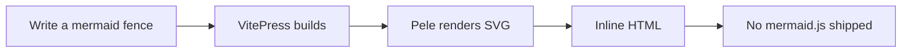

## A diagram, right now

This is a plain `mermaid` fence, compiled during the build and served as inline SVG.

Toggle the color mode in the navbar. The SVG does not re-render — it is themed with CSS variables.

## Why not mermaid.js?

| | mermaid.js plugin | this plugin |
| --- | --- | --- |
| Client JS | ~1.6 MB | **0 bytes** |
| Rendering | in the browser | **at build time** |
| SSR / no-JS | diagram missing | **inline SVG** |
| Layout shift | after hydration | **none** |

Continue with the [quick start](/guide) or browse the [diagram gallery](/gallery).
