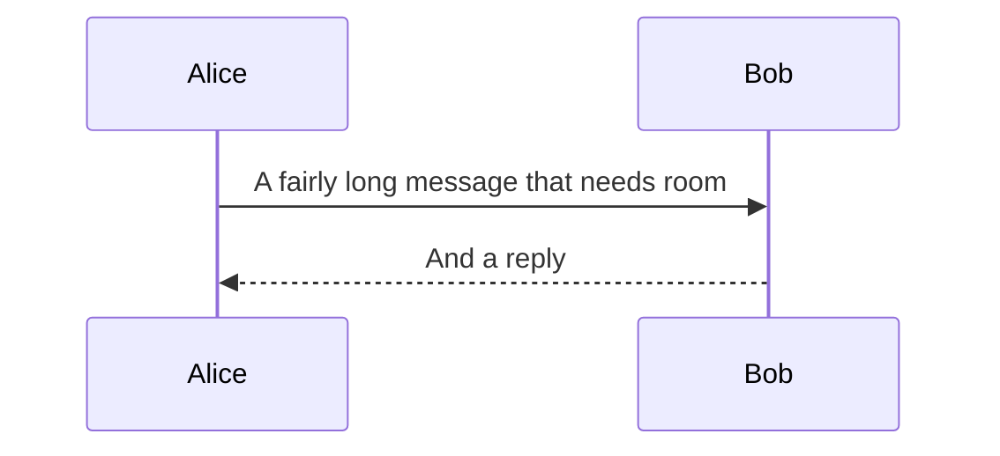

# Sizing and widths

Pele lays diagrams out for a given width. The VitePress entry defaults to the default theme's content column (688px), and you can override it per fence or globally.

## Default width


## Narrow width: `width=320`

The same diagram with less room. Pele wraps labels and switches to a vertical layout.


## Very narrow: `width=220`


## Sequence diagram at `width=300`



## How it works

- `peleMermaid({ maxWidth: 688 })` sets the build-time layout width.
- ` ```mermaid width=360 ` overrides it for one diagram.
- The SVG still has `max-width: 100%`, so it never overflows the content column; very wide diagrams get a horizontal scroll container.

The value is passed to Pele as `maxWidth`. Pele can wrap labels, reduce spacing, and switch supported diagrams to a vertical direction when the layout gets narrow.
