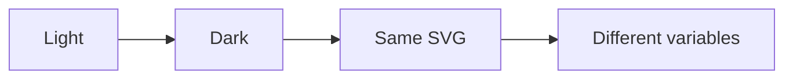
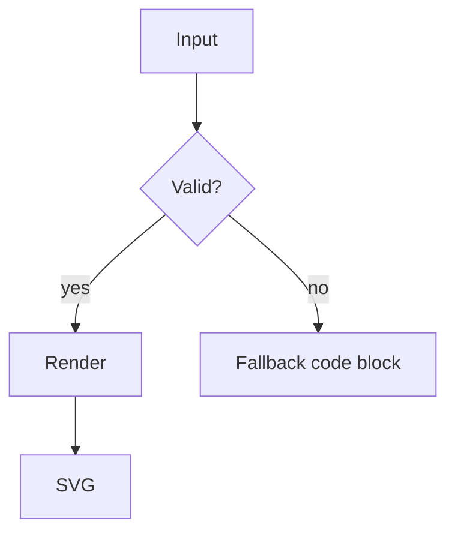

# Theming

Pele colors its SVG with CSS variables, so the same static markup works in light and dark mode. This demo maps the variables to the VitePress palette:

| Pele variable | VitePress variable |
| --- | --- |
| `--pele-bg` | `--vp-c-bg` |
| `--pele-fg` | `--vp-c-text-1` |
| `--pele-muted` | `--vp-c-text-2` |
| `--pele-line` | `--vp-c-text-2` |
| `--pele-surface` | `--vp-c-bg-soft` |
| `--pele-surface-alt` | `--vp-c-bg-alt` |
| `--pele-border` | `--vp-c-divider` |
| `--pele-accent` | `--vp-c-brand-1` |

Toggle the color mode in the navbar — the diagram is not re-rendered, only the CSS variables change.



## Override the palette

The demo already overrides the accent and corner radius in `.vitepress/theme/custom.css`:

```css
:root {
  --pele-accent: var(--vp-c-brand-1);
  --pele-radius: 6px;
}
```

Try your own values in the browser's devtools:

```css
:root {
  --pele-accent: #e11d48;
  --pele-surface: #fff7ed;
  --pele-border: #fdba74;
  --pele-radius: 12px;
}
```



## Per-element styling

Pele exposes classes such as `.pele-node`, `.pele-edge`, `.pele-cluster` and `.pele-label`, so you can restyle one element type without touching the theme:

```css
.pele-diagram .pele-node {
  filter: drop-shadow(0 1px 2px rgb(0 0 0 / 0.15));
}
```

See the [Pele theming guide](https://pele.run/theming) for the complete variable and class reference.
