# 图表库

下面的每个图表都是普通的 `mermaid` 代码围栏，由 Pele 在构建期渲染。本页覆盖 Pele 支持的全部图表类型。打开导航栏的配色开关看看：SVG 会跟随配色变化，而且不需要重新渲染。

## 流程图

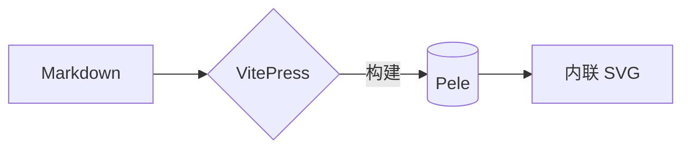

## 序列图

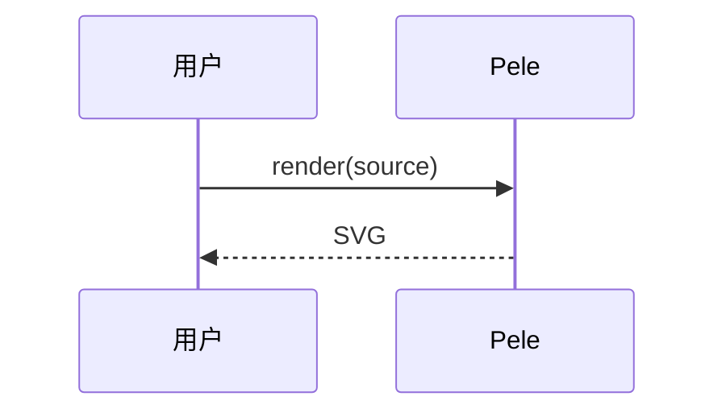

## 状态图

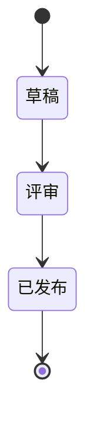

## 类图

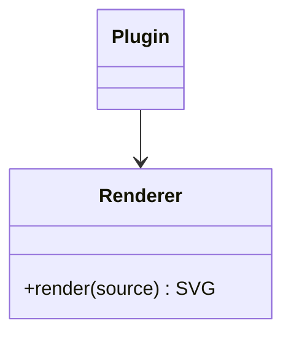

## 实体关系图

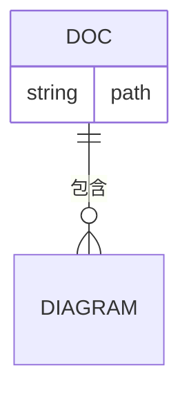

## 甘特图

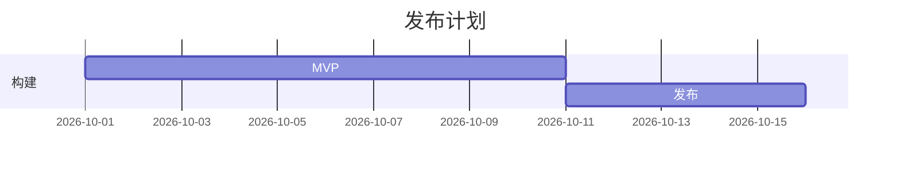

## 饼图

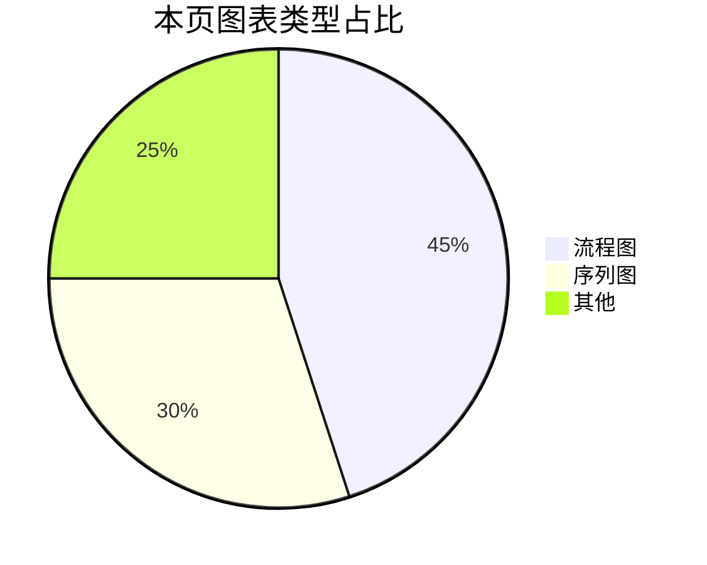

## 思维导图

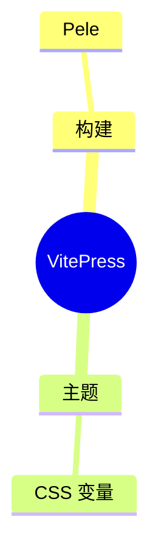

## Git 图

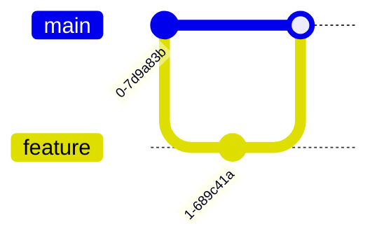

## 旅程图

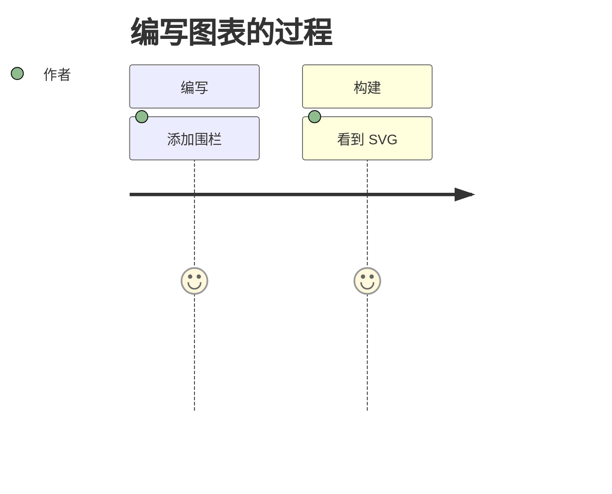

## 时间线

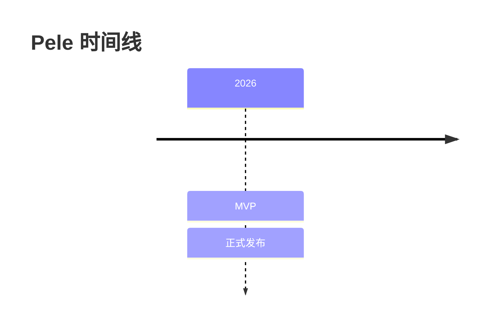

## 四象限图

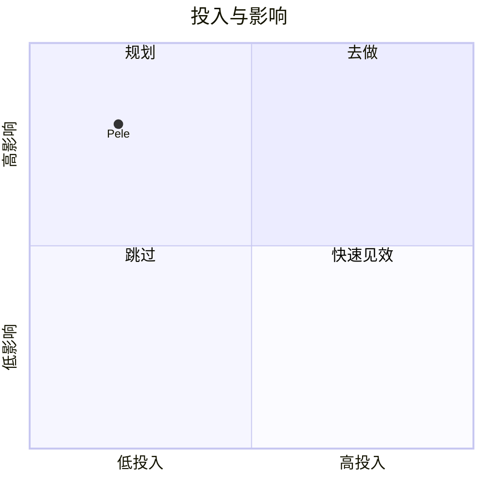

## XY 图

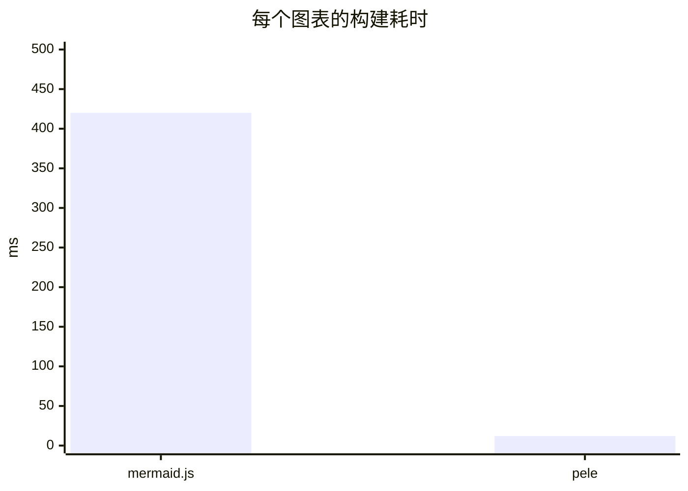

## 需求图

展示需求、元素以及它们之间的关系。

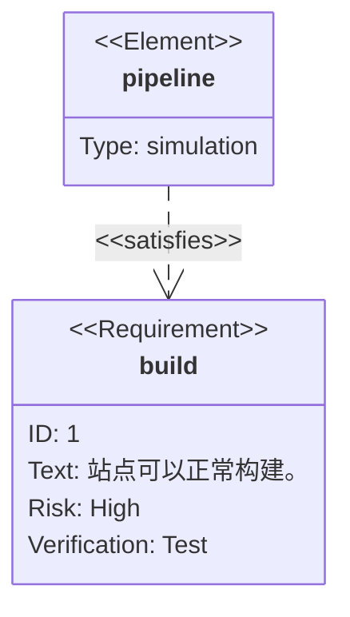

## C4 上下文图

展示人员、系统以及它们之间的关系。

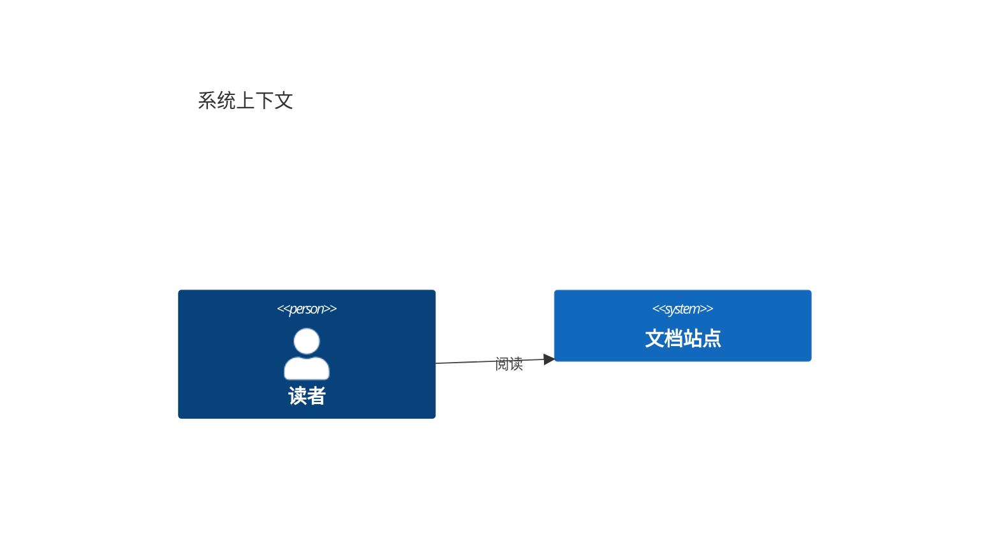

## 桑基图

展示某个量在节点之间如何流动。

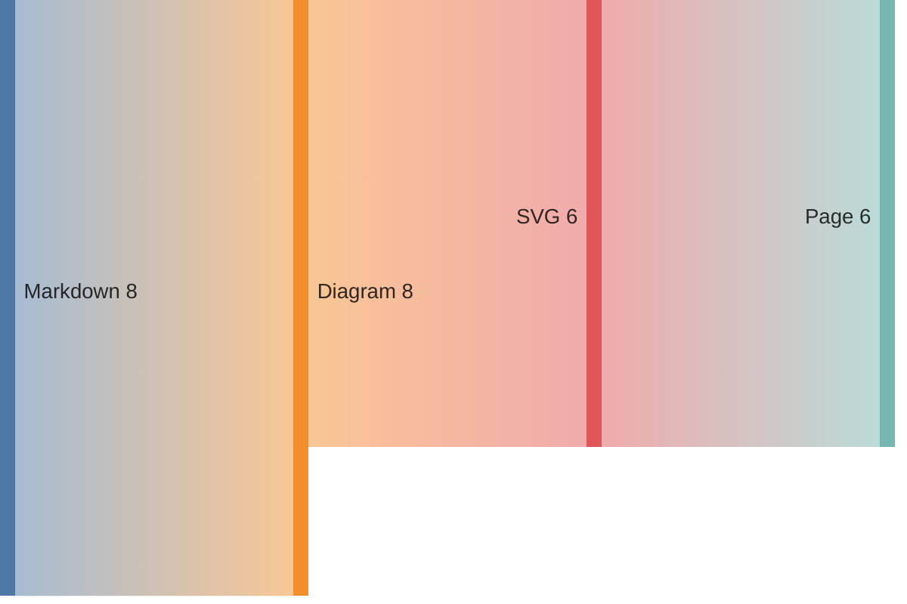

## 块图

由带标签的方块组成的网格。

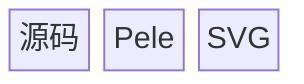

## 数据包图

网络数据包的比特布局。

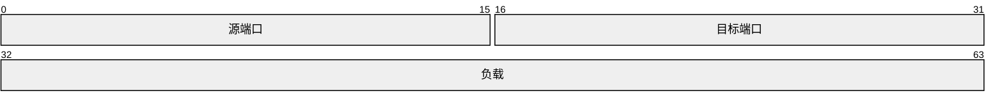

## 看板

按列排列的任务，从待办到完成。

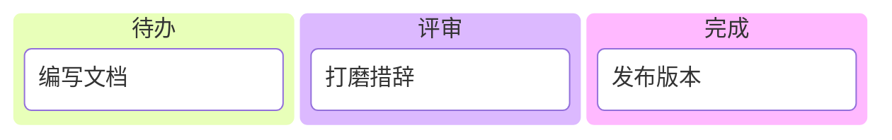

## 架构图

按边界归类的服务。


## 雷达图

一个或多个数据系列共用一组坐标轴。

```mermaid
radar-beta
  axis a["速度"], b["成本"], c["质量"]
  curve mermaids { 3, 2, 4 }
  curve pele { 4, 5, 4 }
```

## 矩形树图

按数值确定大小的嵌套区域。

```mermaid
treemap
  "文档"
    "指南": 8
    "API": 4
  "代码"
    "插件": 6
```

## 信息图

渲染器版本，和其他图表一样处理。

```mermaid
info
```

## 智能体流程图

智能体以及它们使用的工具构成的流程。

```mermaid
agentflow-beta
  user[用户] --> tool[Pele]
  tool --> result[SVG]
```

## 用例图

参与者以及他们触发的用例。

```mermaid
usecase-beta
  actor Reader
  Reader --> Gallery
```

## 铁路图

用铁路图的形式画出一条语法规则。

```mermaid
railroad-beta
  request = sequence(terminal("GET"), terminal("/page"));
```

## 树视图

节点构成的层级结构。

```mermaid
treeView-beta
  root((文档))
    指南
    API
```

## 韦恩图

集合以及它们的交集。

```mermaid
venn-beta
  title 集合
  set A
  set B
  union A, B
```

## Cynefin 域

Cynefin 的五个域及其取向。

```mermaid
cynefin-beta
  complicated
  complex
  clear
```

## Wardley 图

演进程度与可见性的对照。

```mermaid
wardley-beta
  title 地图
  component Web [0.9, 0.8]
  component Docs [0.7, 0.5]
```

## 泳道图

按泳道归类的步骤。

```mermaid
swimlane-beta
  subgraph 客户端
    A[请求]
  end
  subgraph 服务端
    B[响应]
  end
```

## 鱼骨图

因果关系图。

```mermaid
ishikawa-beta
  构建缓慢
    缓存未命中
    资源体积过大
```

## 事件建模

实体以及作用于它们的命令。

```mermaid
eventmodeling
  entity Order
  timeframe 1 command Order
```

## 字面花括号

因为外层使用了 `v-pre` 编译，标签里的 Vue 插值语法会被原样保留：

```mermaid
flowchart LR
  A["{{ mustache }}"] --> B[依然是普通标签]
```
