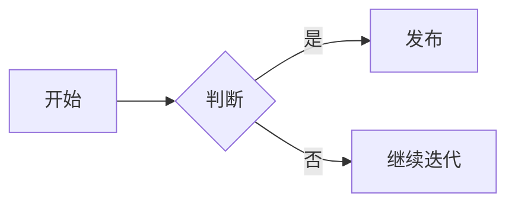
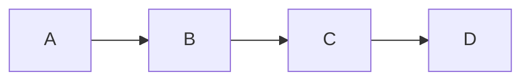

# 快速上手

本演示站运行的是已发布的插件，VitePress 版本为 **2.0.0-alpha.20**（`next` 标签）。除了 VitePress 自身，这个站点没有任何客户端渲染。

## 安装

```bash
pnpm add -D vitepress-plugin-pele
```

## 配置 VitePress

```ts
// .vitepress/config.ts
import { defineConfig } from "vitepress"
import { peleMermaid } from "vitepress-plugin-pele"

export default defineConfig({
  markdown: {
    config: peleMermaid(),
  },
})
```

## 引入样式

```ts
// .vitepress/theme/index.ts
import DefaultTheme from "vitepress/theme"
import "vitepress-plugin-pele/style.css"

export default DefaultTheme
```

## 编写图表

````md

````


集成到此为止，现有的 `mermaid` 代码围栏无需任何改动。

## 单个图表的宽度

当 Pele 知道可用宽度时，可以自动换行标签并切换布局方向。默认宽度为 688px，可以这样覆盖：

````md

````


更多内容见[尺寸与宽度](/zh/sizing)，支持的全部图表类型见[图表库](/zh/gallery)。

## 选项速览

```ts
peleMermaid({
  maxWidth: 688,     // 默认主题内容列的布局宽度
  onError: "warn",   // "warn" | "throw" | "code"
  vueSafe: true,     // 用 v-pre 包裹 SVG，让 Vue 忽略 {{ ... }}
})
```

完整的选项表格见 [README](https://github.com/miswanting/vitepress-plugin-pele#options)。
