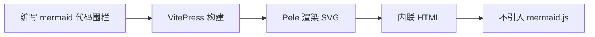

## 立即看一个图表

下面就是一个普通的 `mermaid` 代码围栏，它在构建期被编译，最终以内联 SVG 的形式输出。

在导航栏切换配色模式即可。SVG 不会重新渲染，只是换了一组 CSS 变量。

## 为什么不用 mermaid.js？

| | mermaid.js 插件 | 本插件 |
| --- | --- | --- |
| 客户端 JS | 约 1.6 MB | **0 字节** |
| 渲染时机 | 在浏览器中 | **构建期** |
| SSR / 无 JS | 看不到图表 | **内联 SVG** |
| 布局抖动 | 水合之后才出现 | **没有** |

接下来可以阅读[快速上手](/zh/guide)，或者直接浏览[图表库](/zh/gallery)。
