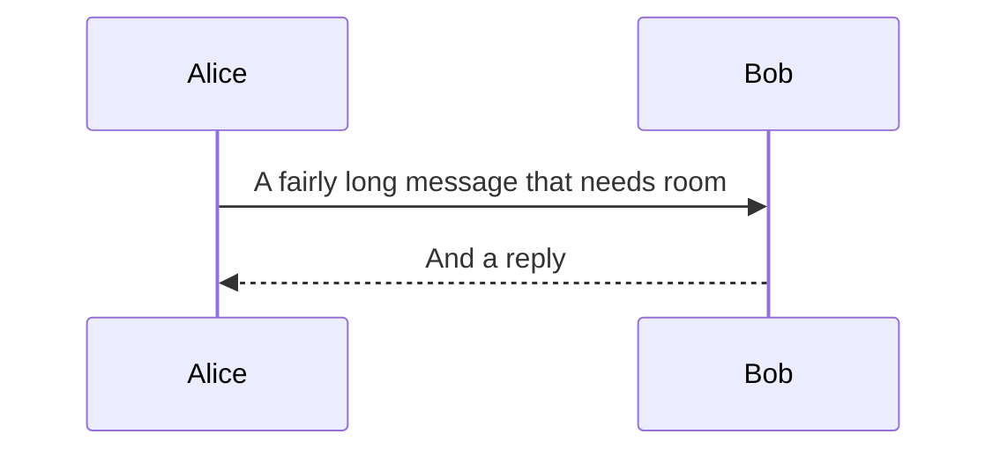

# 尺寸与宽度

Pele 会按照给定的宽度排布图表。VitePress 入口默认使用默认主题的内容列宽度（688px），你可以按围栏或全局覆盖它。

## 默认宽度


## 窄宽度：`width=320`

同样的图表，可用空间更小。Pele 会换行标签并切换为纵向布局。


## 非常窄：`width=220`


## 序列图 `width=300`



## 工作原理

- `peleMermaid({ maxWidth: 688 })` 设置构建期的布局宽度。
- ` ```mermaid width=360 ` 只覆盖单个图表。
- SVG 依然带有 `max-width: 100%`，因此不会溢出内容列；特别宽的图表会放进横向滚动容器。

该值会作为 `maxWidth` 传给 Pele。当布局变窄时，Pele 可以换行标签、压缩间距，并把支持的图表切换为纵向排列。
