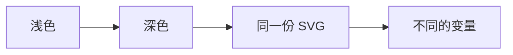
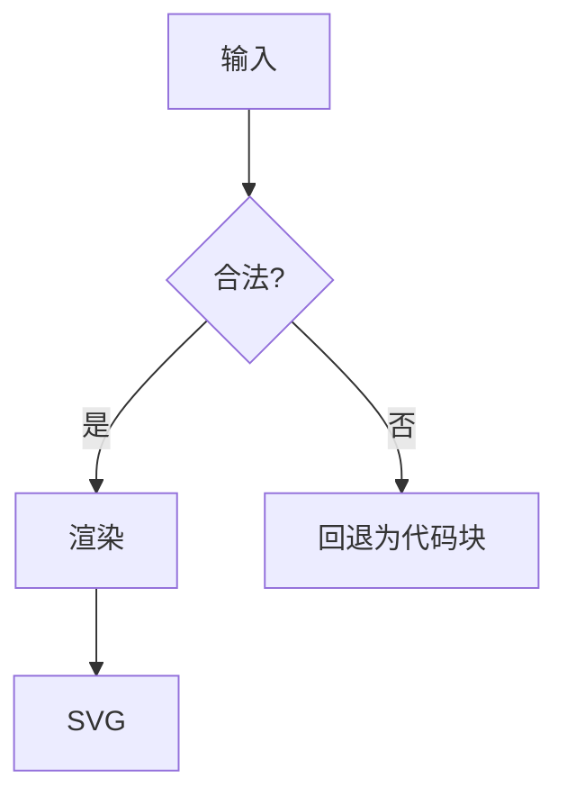

# 主题定制

Pele 用 CSS 变量为 SVG 上色，因此同一份静态标记在浅色与深色模式下都可用。本演示站把这些变量映射到 VitePress 的配色变量：

| Pele 变量 | VitePress 变量 |
| --- | --- |
| `--pele-bg` | `--vp-c-bg` |
| `--pele-fg` | `--vp-c-text-1` |
| `--pele-muted` | `--vp-c-text-2` |
| `--pele-line` | `--vp-c-text-2` |
| `--pele-surface` | `--vp-c-bg-soft` |
| `--pele-surface-alt` | `--vp-c-bg-alt` |
| `--pele-border` | `--vp-c-divider` |
| `--pele-accent` | `--vp-c-brand-1` |
| `--pele-critical` | `--vp-c-danger-1` |
| `--pele-error` | `--vp-c-danger-1` |
| `--pele-fg-on-dark` | `--vp-c-white` |
| `--pele-fg-on-light` | `--vp-c-black` |

在导航栏切换配色模式——图表不会被重新渲染，只是 CSS 变量变了。



## 覆盖配色

本演示站已经在 `.vitepress/theme/custom.css` 里覆盖了强调色和圆角：

```css
:root {
  --pele-accent: var(--vp-c-brand-1);
  --pele-radius: 6px;
}
```

可以在浏览器开发者工具里试自己的取值：

```css
:root {
  --pele-accent: #e11d48;
  --pele-surface: #fff7ed;
  --pele-border: #fdba74;
  --pele-radius: 12px;
}
```



## 按元素定制样式

Pele 提供了 `.pele-node`、`.pele-edge`、`.pele-cluster`、`.pele-label` 等类名，因此可以只调整某一种元素的样式而不必改动主题：

```css
.pele-diagram .pele-node {
  filter: drop-shadow(0 1px 2px rgb(0 0 0 / 0.15));
}
```

完整的变量与类名参考见 [Pele 主题定制指南](https://pele.run/theming)。
